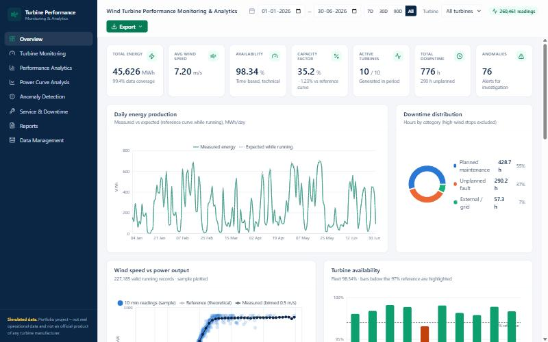
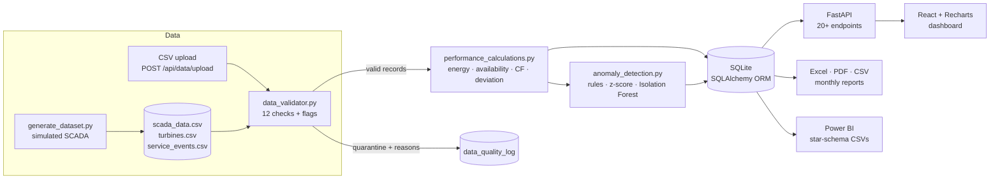
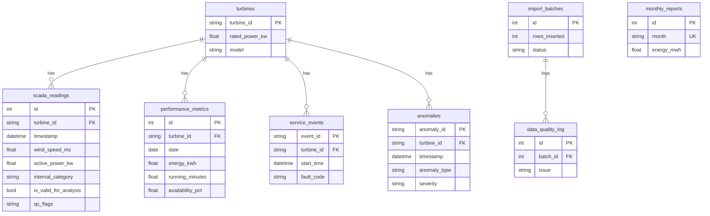
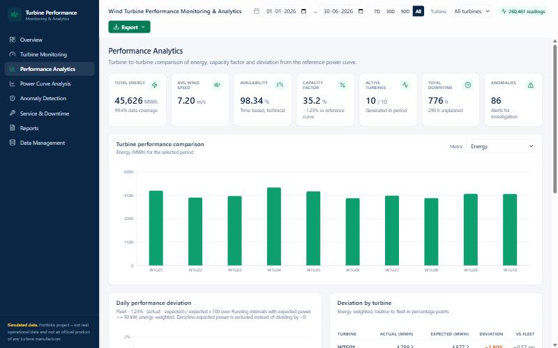
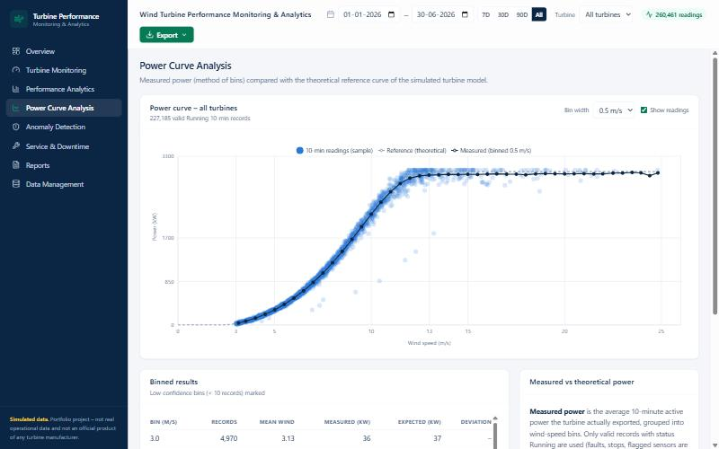
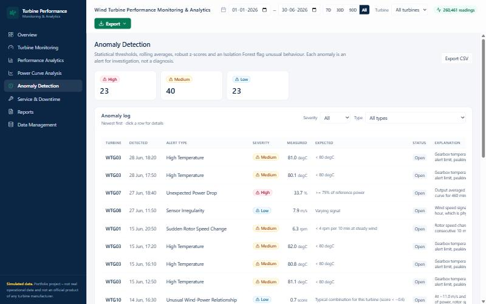
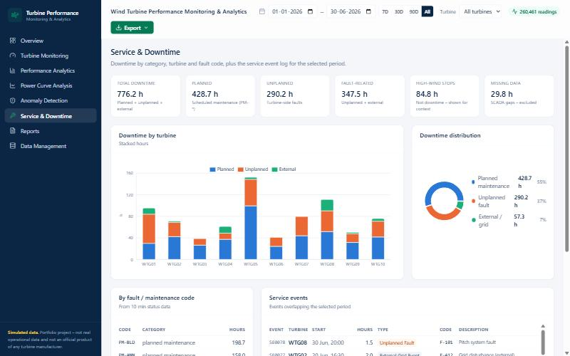
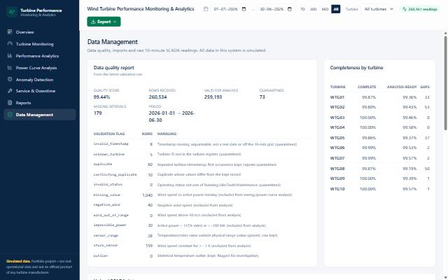
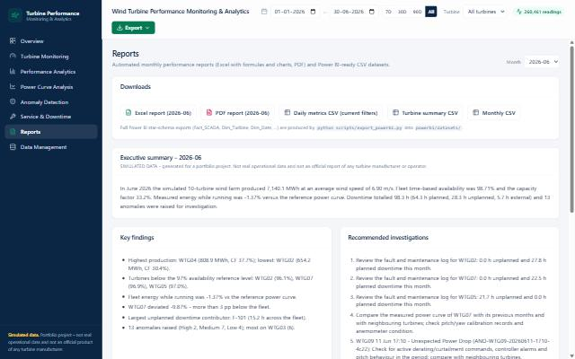

# Wind Turbine Performance Monitoring & Analytics Dashboard

A complete, working portfolio project for **wind-turbine performance reporting**: synthetic SCADA
generation → data validation → engineering KPIs → explainable anomaly detection → SQL database →
REST API → React dashboard → automated Excel/PDF reports → Power BI-ready star schema.

> ⚠️ **Simulated data.** Every number in this repository comes from a synthetic data generator with
> documented engineering assumptions. It is **not** real operational data from any manufacturer or
> operator, and this project is **not** an official product of any turbine manufacturer.

**Live demo:** https://wind-turbine-analytics.onrender.com · API docs: https://wind-turbine-analytics.onrender.com/docs  
*(free hosting – the first visit after ~15 min of inactivity takes 30–60 s to wake up; uploads are disabled in the demo)*



---

## Contents
1. [Problem statement & objectives](#1-problem-statement--objectives)
2. [Architecture](#2-architecture)
3. [Technology stack](#3-technology-stack)
4. [Dataset](#4-dataset)
5. [KPI formulas](#5-kpi-formulas)
6. [Anomaly detection](#6-anomaly-detection)
7. [Database schema](#7-database-schema)
8. [API](#8-api)
9. [Dashboard](#9-dashboard)
10. [Reports & Power BI](#10-reports--power-bi)
11. [Installation (Windows)](#11-installation-windows)
12. [Testing](#12-testing)
13. [Project structure](#13-project-structure)
14. [Limitations & future work](#14-limitations--future-work)

---

## 1. Problem statement & objectives

A wind-farm performance analyst receives 10-minute SCADA data from every turbine and has to answer,
every month: *Did the turbines produce what they should have? If not, why – wind, availability or
under-performance? Which turbines need investigation?*

This project automates that workflow:

| Objective | Implemented as |
|---|---|
| Trustworthy input data | Validation pipeline with 12 checks, quarantine, quality report – nothing silently deleted |
| Correct, explainable KPIs | Energy, availability (3 configurable bases), capacity factor, deviation, downtime – unit-tested |
| Early warning | 6 anomaly methods, each alert with measured value, expected range, explanation and suggested check |
| Self-service analysis | FastAPI + React dashboard where every chart responds to date and turbine filters |
| Monthly reporting | One-command Excel (formulas + charts) and PDF report with findings and recommendations |
| BI integration | Star-schema CSVs + DAX measures + step-by-step Power BI layout |

## 2. Architecture



Request flow: the dashboard sends `start_date`, `end_date`, `turbine_id` on every call; the API
aggregates **daily metric rows in SQL** (SUM/GROUP BY) and computes ratios from the summed
components, so any date range gives mathematically correct KPIs in ~20–100 ms.

## 3. Technology stack

| Layer | Tools |
|---|---|
| Backend | Python 3.11+ (developed on 3.14), FastAPI, Pydantic v2, Pandas, NumPy, SciPy, scikit-learn |
| Database | SQLite + SQLAlchemy 2 ORM (unique constraints, indexes, upserts) |
| Frontend | React 18, TypeScript, Vite, Tailwind CSS 4, Recharts, Lucide icons, React Router |
| Reporting | OpenPyXL (Excel with formulas/charts), ReportLab + Matplotlib (PDF), CSV |
| Testing | Pytest, FastAPI TestClient (90 tests) |
| Deployment | Windows PowerShell setup scripts, single-service Docker image, Render (free tier) |

## 4. Dataset

Generated by [`backend/app/services/generate_dataset.py`](backend/app/services/generate_dataset.py):

* **10 turbines × 181 days (1 Jan – 30 Jun 2026) × 144 readings/day = 260 640 intervals**
  (260 534 rows after injected gaps, duplicates and bad rows).
* Generic **3.0 MW, 112 m rotor** reference turbine; cut-in 3 m/s, rated ≈13 m/s, cut-out 25 m/s.
* Wind from a Weibull-distributed, auto-correlated process with seasonal/diurnal cycles and three storms.
* Power, rotor speed, pitch and temperatures are **derived from wind and operating state** (power
  curve, thermal lag, gearbox ratio), not random numbers.
* Realistic scenarios: low wind, high-wind shutdowns, planned maintenance, faults, a turbine with
  sustained −7 % under-performance (WTG07), gearbox temperature drift and ramp before a trip (WTG03),
  sudden power drops, rotor-speed steps, and data problems (gaps, NaNs, negative wind, stuck
  anemometers, power spikes, sensor faults, duplicates, bad timestamps, unknown IDs).
* Ground truth of every injected scenario: `data/generated/scenario_log.csv`.

Details: [docs/engineering_assumptions.md](docs/engineering_assumptions.md) ·
column definitions: [docs/data_dictionary.md](docs/data_dictionary.md).

**Headline results on the default dataset** (from the API, all simulated):

| Energy | Avg wind | Availability | Capacity factor | Deviation vs curve | Downtime | Anomalies | Data quality |
|---|---|---|---|---|---|---|---|
| 45 626 MWh | 7.20 m/s | 98.34 % | 35.21 % | −1.23 % | 776 h (429 planned / 290 unplanned / 57 grid) | 76 | 99.44 % |

## 5. KPI formulas

| KPI | Formula | Notes |
|---|---|---|
| **Energy** | E (kWh) = P̄ (kW) × t (h); each 10-min record = P̄ × 1/6 h | Invalid power not gap-filled; aggregated hourly/daily/monthly/turbine/farm |
| **Availability** | available time ÷ eligible time × 100 | Each record → one of 7 categories. *Technical* (default): faults + planned maintenance unavailable, grid events & data gaps excluded, high-wind stops available. *Contractual*: planned maintenance also excluded. *Strict*: everything counts. `?basis=` on the API |
| **Capacity factor** | actual energy ÷ (rated power × eligible hours) × 100 | Eligible hours = hours with valid power data |
| **Performance deviation** | (actual − expected) ÷ expected × 100 | Only Running records with expected ≥ 50 kW (zero expected → undefined, never ÷0). Aggregated energy-weighted |
| **Downtime** | planned + unplanned + external | Per category, per turbine, per fault code; high-wind stops and data gaps shown separately |
| **Power curve** | Method of bins, 0.5 m/s | Measured = mean power of valid Running records per bin; theoretical = reference curve at the bin mean wind |

**Measured vs theoretical power:** *measured* power is what the turbine actually exported; *theoretical*
power is what the reference power curve says it should export at the measured wind speed. The gap is
the performance deviation – a signal to investigate (pitch/yaw calibration, blade condition, derating,
anemometer), not a diagnosis.

Code: [`backend/app/analytics/`](backend/app/analytics) (`energy_analysis.py`, `availability.py`,
`performance_calculations.py`, `power_curve.py`, `downtime_analysis.py`).

## 6. Anomaly detection

[`anomaly_detection.py`](backend/app/analytics/anomaly_detection.py) – every alert carries
*measured value, expected range, explanation, recommended investigation, method* and status `Open`.

| Method | Detects | Technique |
|---|---|---|
| Unexpected power drop | Output < 75 % of reference for ≥ 30 min while Running | Threshold + 30-min rolling median |
| Sustained under-performance | Turbine lagging the fleet for ≥ 5 days | 7-day rolling mean of fleet-relative daily deviation |
| High temperature | Gearbox > 80/90 °C, generator > 110/125 °C | Absolute limits (sensor errors excluded) |
| Abnormal temperature (fleet-relative) | Component ≥ 12 °C hotter than steady-running neighbours | Residual vs fleet median + robust z-score (MAD) |
| Sudden rotor speed change | > 4 rpm step in 10 min at steady wind | Z-score of rotor-speed differences |
| Operating condition rules | Running above cut-out, power while stopped, running without output, stuck anemometer | Rule checks |
| Unusual wind–power relationship (optional) | Rare combinations of power / rotor / pitch residuals | Isolation Forest per turbine on physics-normalised residuals |

Validated against the injected ground truth in the tests (power-drop recall ≥ 60 % required; the
WTG03 gearbox ramp and the stuck anemometers must be found). Two false-positive sources found
during development were fixed: storms (raw features → residual features) and turbines restarting
after a storm (fleet reference now uses steady-running turbines only).

> An anomaly is an **alert for investigation, not proof of equipment failure.**

## 7. Database schema



* `UNIQUE(turbine_id, timestamp)` + `INSERT … ON CONFLICT DO NOTHING` → re-importing a file never
  duplicates data. Indexes on `(turbine_id, timestamp)` and `timestamp`.
* `performance_metrics` stores **minutes per availability category**, so availability can be recomputed
  for any range and any basis without touching the 260 k raw rows.
* 12 verified analysis queries (window functions, joins, power-curve binning): [sql/performance_queries.sql](sql/performance_queries.sql)
  – run them all with `python scripts/run_sql.py sql/performance_queries.sql`.

## 8. API

Interactive docs: **http://localhost:8000/docs**. Common filters: `start_date`, `end_date`
(inclusive, `YYYY-MM-DD`), `turbine_id`. Invalid ranges → 422, unknown turbine → 404.

| Method | Endpoint | Purpose |
|---|---|---|
| GET | `/api/health` | DB status, record counts, data period, last import |
| GET | `/api/turbines` | Turbine register |
| GET | `/api/turbines/status` | Status table: latest reading + period KPIs + latest alert per turbine |
| GET | `/api/turbines/{turbine_id}` | One turbine: details, latest reading, period KPIs |
| GET | `/api/scada` | 10-min readings, paginated (`page`, `page_size` ≤ 1000, `operating_status`, `flagged_only`) |
| GET | `/api/metrics/summary` | Headline KPIs (`basis=technical\|contractual\|strict`) |
| GET | `/api/metrics/daily` | Daily KPIs, farm or `by_turbine=true` |
| GET | `/api/metrics/monthly` | Monthly KPIs, farm or `by_turbine=true` |
| GET | `/api/metrics/availability` | Availability per turbine with hour breakdown and definition |
| GET | `/api/metrics/capacity-factor` | Energy, eligible hours, max possible energy, CF |
| GET | `/api/metrics/power-curve` | Bins, reference curve, sampled scatter (`bin_width`, `scatter_points`) |
| GET | `/api/metrics/performance-deviation` | Deviation per turbine, vs fleet, daily trend |
| GET | `/api/metrics/temperature` | Daily component temperatures |
| GET | `/api/anomalies` | Paginated anomalies (`severity`, `anomaly_type`) + facet counts |
| GET | `/api/downtime` | Totals, per turbine, per fault code, service events |
| GET | `/api/reports/months` | Months available |
| GET | `/api/reports/monthly` | Full monthly report as JSON (`month=YYYY-MM`) |
| GET | `/api/reports/pdf` | Monthly PDF (generated on demand) |
| GET | `/api/export/excel` | Monthly Excel workbook |
| GET | `/api/export/csv` | `dataset=daily\|monthly\|turbine_summary\|anomalies\|scada`, filtered |
| POST | `/api/data/upload` | Upload SCADA CSV → validate → insert new rows → background recompute (202) |
| GET | `/api/data/imports`, `/api/data/imports/{id}` | Import history / recompute status |
| GET | `/api/data/quality` | Latest data-quality report |

## 9. Dashboard

White/light-grey industrial layout, navy typography, green accent. Sidebar pages: **Overview,
Turbine Monitoring, Performance Analytics, Power Curve Analysis, Anomaly Detection, Service &
Downtime, Reports, Data Management**. Top bar: date range (with 7D/30D/90D/All presets), turbine
selector, live data status, export menu. Every component fetches from the API (no hard-coded chart
values) and has loading, empty and error states.

| | |
|---|---|
|  |  |
|  |  |
|  |  |

Charts: daily energy (line, measured vs expected), wind vs power (scatter + binned curve +
reference), availability by turbine (bar, 97 % reference line), monthly energy (area), turbine
comparison (bar, selectable metric), power curve, downtime distribution (donut), temperature trends
(line), deviation trend, stacked downtime by turbine.

## 10. Reports & Power BI

```bash
python scripts/generate_reports.py               # all months
python scripts/generate_reports.py --month 2026-03
```

* **Excel** `reports/excel/monthly_report_YYYY-MM.xlsx` – sheets *Executive Summary, Turbine
  Performance, Daily Energy, Monthly Energy, Availability, Downtime, Anomalies, Data Quality*;
  capacity-factor and totals as live Excel formulas, native Excel charts, units in every header.
* **PDF** `reports/pdf/monthly_report_YYYY-MM.pdf` – the 12 required sections (executive summary →
  recommended investigations) with charts.
* **CSV** `reports/csv/YYYY-MM/*.csv` – the month's tables.

Power BI: `python scripts/export_powerbi.py` writes `Fact_SCADA, Fact_Performance, Fact_Anomalies,
Fact_ServiceEvents, Dim_Turbine, Dim_Date` to `powerbi/datasets/`. Import steps, relationships,
page layout: [powerbi/powerbi_guide.md](powerbi/powerbi_guide.md). DAX measures:
[powerbi/dax_measures.md](powerbi/dax_measures.md). *No `.pbix` is included – it has to be built in
Power BI Desktop following the guide.*

## 11. Installation (Windows)

Prerequisites: **Python 3.11+** (python.org, "Add to PATH"), **Node.js 20+**, PowerShell.

### One command

```bash
setup.bat
```

(or `powershell -ExecutionPolicy Bypass -File scripts\setup_windows.ps1`). It creates `.venv`,
installs dependencies, generates the simulated data, builds the database, generates reports and
Power BI files, and installs frontend packages (~1–3 min after downloads).

### Step by step (what the script does)

```bash
python -m venv .venv
```
```bash
.venv\Scripts\python -m pip install -r backend\requirements.txt
```
```bash
.venv\Scripts\python scripts\generate_data.py
```
```bash
.venv\Scripts\python scripts\run_pipeline.py
```
```bash
.venv\Scripts\python scripts\generate_reports.py
```
```bash
.venv\Scripts\python scripts\export_powerbi.py
```
```bash
cd frontend && npm install
```

### Run

Terminal 1 – backend (http://localhost:8000/docs):
```bash
powershell -ExecutionPolicy Bypass -File scripts\start_backend.ps1
```
Terminal 2 – dashboard (http://localhost:5173):
```bash
powershell -ExecutionPolicy Bypass -File scripts\start_frontend.ps1
```

### Docker (optional)

```bash
docker compose up --build
```
One container serves both the dashboard (http://localhost:8000) and the API (http://localhost:8000/docs).
The image builds the simulated dataset, database and reports at build time.

### Cloud deployment (Render)

The root `Dockerfile` is a single web service: FastAPI serves the built React app from the same
origin (`WTA_STATIC_DIR`), so there is no CORS setup. The public demo runs with `WTA_DEMO_MODE=1`,
which disables CSV uploads: a recompute needs ~650 MB RAM, more than the free tier's 512 MB, and a
public demo should not accept data from strangers. `render.yaml` describes the service, or create it
from the CLI:

```bash
render services create --name wind-turbine-analytics --type web_service --runtime docker --plan free --repo https://github.com/<you>/wind-turbine-analytics --branch main --health-check-path /api/health --output json
```

Free Render services sleep after ~15 minutes without traffic; the first request then takes ~30–60 s.

### Windows notes

* **Smart App Control / Application Control** blocked native DLLs of `scikit-learn ≥ 1.8` and
  Rollup's native binary on the development machine. The project therefore pins
  `scikit-learn==1.7.2` and uses Rollup's official WebAssembly build via an `overrides` entry in
  `frontend/package.json`. If scikit-learn still cannot load, the Isolation Forest step is skipped
  with a logged warning and all rule-based detection continues.
* Keep the project in a short path (e.g. `C:\Projects\wind-turbine-analytics`): Windows' 260-character
  path limit can stop Python from loading compiled extensions from deeply nested folders.

## 12. Testing

```bash
cd backend && ..\.venv\Scripts\python -m pytest -v
```

Last executed run (Windows 11, Python 3.14, see [docs/test_results.txt](docs/test_results.txt)):

```
90 passed in 9.52s
```

| File | Tests | Covers |
|---|---|---|
| test_generation.py | 6 | size, schema, engineering relationships (power vs curve, states vs wind, gear ratio), determinism, injected errors |
| test_validation.py | 13 | missing columns, duplicates (exact/conflicting), 5 invalid-timestamp cases, negative wind, impossible power, unknown IDs, NaNs, stuck sensor, quality report |
| test_calculations.py | 14 | energy, hourly/daily aggregation, availability (all bases, edge cases), capacity factor, deviation with zero expected, reference curve, a hand-computed daily example, downtime |
| test_power_curve_and_anomalies.py | 11 | binning accuracy, filtering, each anomaly method on crafted data, sensor errors not alarmed, deterministic IDs, recall vs injected ground truth |
| test_database.py | 7 | load, idempotent re-insert, unique constraint, indexes, SQL vs pandas KPI equality, filters, quarantine log |
| test_api.py | 34 | every GET endpoint, filters, pagination, validation errors (404/422), report & export downloads, upload (new + duplicate + bad rows, re-upload, wrong schema/type/empty) |
| test_reports.py | 5 | report sections, Excel sheets/formulas/charts, PDF, Power BI relationship integrity, date dimension |

Frontend: `npm run build` (TypeScript strict type-check + production build) passes. The dashboard
was checked in a browser against the live API (all 8 pages, turbine and date filters).

## 13. Project structure

```
wind-turbine-analytics/
├── backend/
│   ├── app/
│   │   ├── main.py                 FastAPI app
│   │   ├── api/                    routes_core, routes_metrics, routes_operations, routes_reports, deps
│   │   ├── analytics/              turbine_model, energy_analysis, availability, performance_calculations,
│   │   │                           power_curve, downtime_analysis, anomaly_detection
│   │   ├── services/               generate_dataset, data_validator, data_processor, data_quality_report, pipeline
│   │   ├── database/               db (engine/session), repository (inserts + SQL aggregation)
│   │   ├── models/models.py        SQLAlchemy ORM (8 tables)
│   │   ├── schemas/schemas.py      Pydantic response models
│   │   ├── reports/                monthly_report, excel_report, pdf_report, powerbi_export, report_service
│   │   └── core/config.py          settings (.env aware)
│   ├── tests/                      90 pytest tests
│   └── requirements.txt
├── frontend/                       React + Vite + TS + Tailwind + Recharts
│   └── src/ components/ pages/ charts/ services/ layouts/ context/ hooks/
├── data/ generated/ processed/ raw/      (created by the scripts)
├── reports/ excel/ pdf/ csv/
├── powerbi/ datasets/ dax_measures.md powerbi_guide.md
├── sql/performance_queries.sql
├── scripts/                        generate_data, run_pipeline, generate_reports, export_powerbi, run_sql,
│                                   setup_windows.ps1, start_backend.ps1, start_frontend.ps1, run_tests.ps1
├── docs/                           engineering_assumptions, data_dictionary, test_results, screenshots/
├── Dockerfile  docker-compose.yml  render.yaml  setup.bat  .env.example  .gitignore  TODO.md
```

## 14. Limitations & future work

**Limitations**
* Synthetic data only; the generator is plausible but simpler than real turbine behaviour (no wake
  model by direction, no icing, no curtailment signals, first-order thermal model).
* Power curve uses the nacelle anemometer without air-density normalisation (not an IEC 61400-12-1 test).
* Thresholds (75 % power ratio, 80/90 °C, 12 °C fleet residual) are reasonable defaults, not tuned on real data.
* After an upload, KPIs and anomalies are rebuilt for the whole fleet (~30 s on 260 k rows); stored
  per-row QC flags of existing readings are not rewritten.
* SQLite is single-writer; fine for one analyst, not for concurrent ingestion.
* The Docker image was not built on the development machine (Docker daemon not running); it is built by Render on deploy.
* No authentication – intended for local use.

**Future enhancements**
* Air-density-corrected power curves and per-turbine learned (normal-behaviour) models.
* Lost-production / energy-based availability (IEC 61400-26-2) alongside time-based.
* Anomaly workflow (acknowledge, comment, close) and e-mail alerts.
* PostgreSQL/TimescaleDB, scheduled ingestion, incremental recompute.
* Wind-direction rose and yaw-misalignment analysis; turbine map view.
