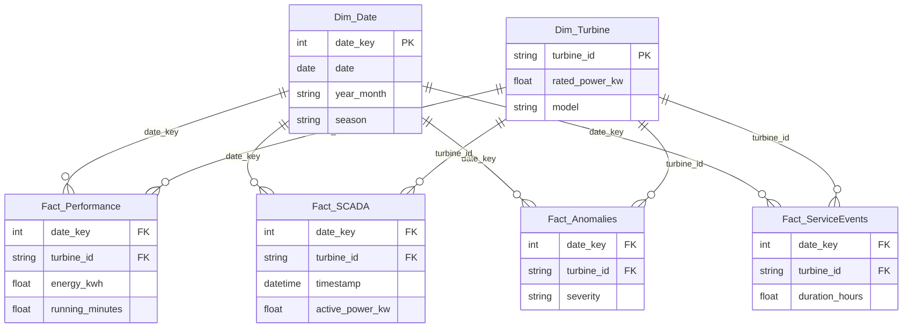

# Power BI integration guide

This project produces **Power BI-ready CSV datasets** and a documented report design.
It does **not** ship a `.pbix` file: Power BI Desktop cannot be automated from this
environment, so the report is built by following the steps below (≈30 minutes).

## 1. Produce the datasets

```bash
python scripts/export_powerbi.py
```

Files written to `powerbi/datasets/` (use `--no-scada` to skip the ~32 MB 10-minute table):

| File | Rows (default data) | Role |
|---|---|---|
| Fact_SCADA.csv | ~260 000 | 10-minute measurements |
| Fact_Performance.csv | 1 810 | Daily KPIs per turbine (main fact) |
| Fact_Anomalies.csv | ~76 | Detected anomalies |
| Fact_ServiceEvents.csv | ~78 | Maintenance and fault events |
| Dim_Turbine.csv | 10 | Turbine register |
| Dim_Date.csv | 181 | Calendar |

## 2. Star schema



Relationships: all **many-to-one, single direction** (dimension filters fact). No fact-to-fact
relationships – compare facts through the shared dimensions.

## 3. Import in Power BI Desktop

1. **Home → Get data → Text/CSV**, select `Dim_Date.csv` → **Transform Data**.
2. In Power Query set types: `date_key` Whole number, `date` Date, `is_weekend` True/False.
   Repeat for every file (Get data → Text/CSV). Key types to check:
   * `Fact_SCADA[timestamp]` → Date/Time, `is_valid_for_analysis` → True/False
   * all `*_kwh`, `*_minutes`, `*_pct`, `*_c`, `*_ms` → Decimal number
   * `Fact_Anomalies[timestamp]`, `end_timestamp` → Date/Time
   * Set **Data source settings → File origin = 65001 (UTF-8)**, delimiter = comma.
3. **Close & Apply.**
4. **Model view**: create relationships `Dim_Date[date_key] → <fact>[date_key]` and
   `Dim_Turbine[turbine_id] → <fact>[turbine_id]` (Cardinality many-to-one, single direction).
   Delete any auto-detected relationships between facts.
5. Select `Dim_Date` → **Table tools → Mark as date table** → column `date`.
6. Sort `Dim_Date[month_name]` by `month_number` (Column tools → Sort by column).
7. Hide the key columns on the fact tables (right-click → Hide in report view).
8. Create the measures from [dax_measures.md](dax_measures.md).

To refresh after re-running the pipeline: re-export the CSVs and press **Refresh**.

## 4. Report layout (3 pages)

Theme: white canvas, navy (#0B2545) text, green (#0E9F6E) accent, one highlight colour
(#C2410C) for values below target. Add a text box on every page:
"Simulated data – portfolio project".

### Page 1 – Fleet overview

| Area | Visual | Fields |
|---|---|---|
| Top band | Slicers: **Date range** (between) on `Dim_Date[date]`, **Turbine** (dropdown, multi-select) on `Dim_Turbine[turbine_id]` | sync slicers across pages |
| Row 1 | 6 **Card** visuals | Total Energy (MWh), Average Wind Speed, Average Availability (%), Capacity Factor (%), Total Downtime (Hours), Anomaly Count |
| Row 2 left | **Line chart** – Daily energy | X `Dim_Date[date]`, Y Total Energy (MWh) |
| Row 2 right | **Donut** – Downtime split | Values: planned, unplanned, external hours (three measures) |
| Row 3 left | **Clustered column** – Availability by turbine | X `Dim_Turbine[turbine_id]`, Y Average Availability (%), constant line at 97 |
| Row 3 right | **Area chart** – Monthly energy | X `Dim_Date[year_month]`, Y Total Energy (MWh) |

### Page 2 – Turbine performance

| Visual | Fields |
|---|---|
| **Table / matrix** with conditional formatting | Rows `turbine_id`; values Total Energy, Capacity Factor, Availability, Performance Deviation (%), Deviation vs Fleet (pp), Total Downtime, Anomaly Count. Background colour rule on deviation: < −3 → orange |
| **Scatter chart** – Power curve | X `Fact_SCADA[wind_speed_ms]` (Don't summarise), Y `Fact_SCADA[active_power_kw]`, filter `operating_status = Running` and `is_valid_for_analysis = True`; enable *high-density sampling* |
| **Line chart** – Measured vs expected | X binned `wind_speed_ms` (New group, bin size 0.5), Y average `active_power_kw` and average `theoretical_power_kw` |
| **Column chart** – Deviation by turbine | X turbine_id, Y Performance Deviation (%) |

### Page 3 – Reliability & anomalies

| Visual | Fields |
|---|---|
| **Stacked column** – Downtime by turbine | X turbine_id, Y planned / unplanned / external minutes ÷ 60 |
| **Bar chart** – Downtime by fault code | Axis `Fact_ServiceEvents[fault_code]`, value Sum of duration_hours |
| **Table** – Anomaly log | timestamp, turbine_id, anomaly_type, severity, measured_value, unit, explanation, recommended_investigation |
| **Slicer** | `Fact_Anomalies[severity]`, `anomaly_type` |
| **Line chart** – Temperature trend | X date, Y average gearbox / generator temperature from Fact_Performance |

### Interactions and drill-through

* Add a **drill-through page** "Turbine detail" with `Dim_Turbine[turbine_id]` as drill-through field
  (daily energy, temperature trend, anomalies for that turbine).
* Set the anomaly table to *filter* (not highlight) the other visuals.

## 5. Validation checklist

* [ ] Cards match `/api/metrics/summary` for the same date range (see the numbers in dax_measures.md).
* [ ] Selecting WTG07 for April–June shows a deviation of about −8.6 % (the injected scenario).
* [ ] Total of the daily energy line = Total Energy card.
* [ ] Fleet availability is computed from summed minutes, so it is *not* equal to the simple average of the per-turbine availability column (the API returns the same ratio-of-sums value).
